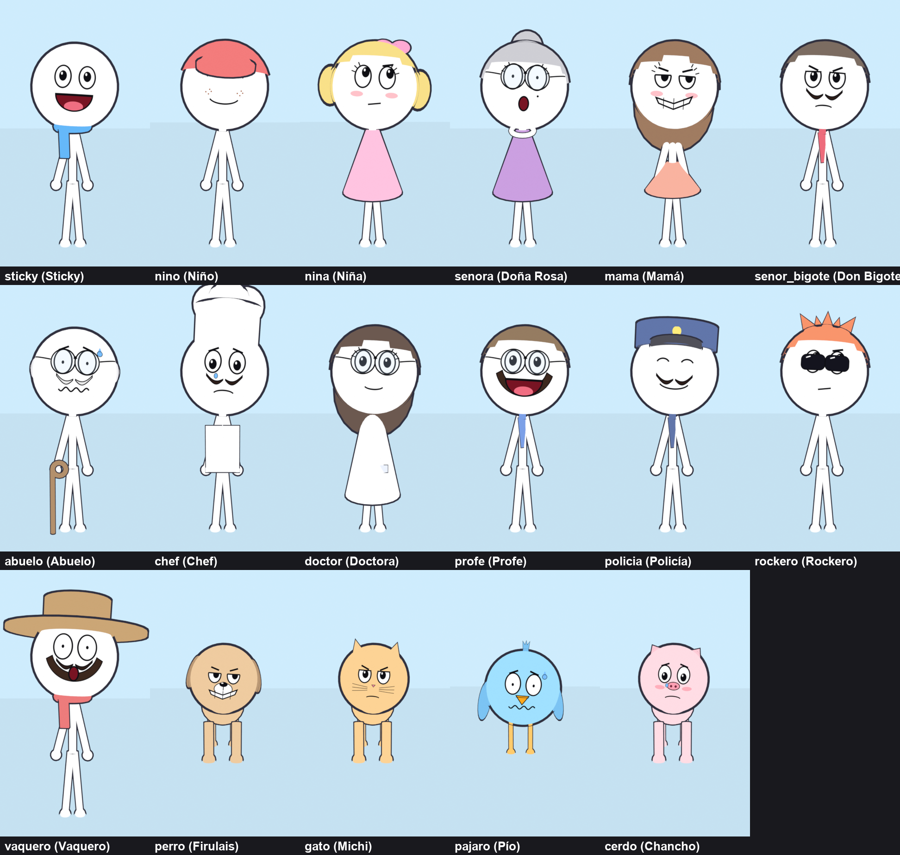
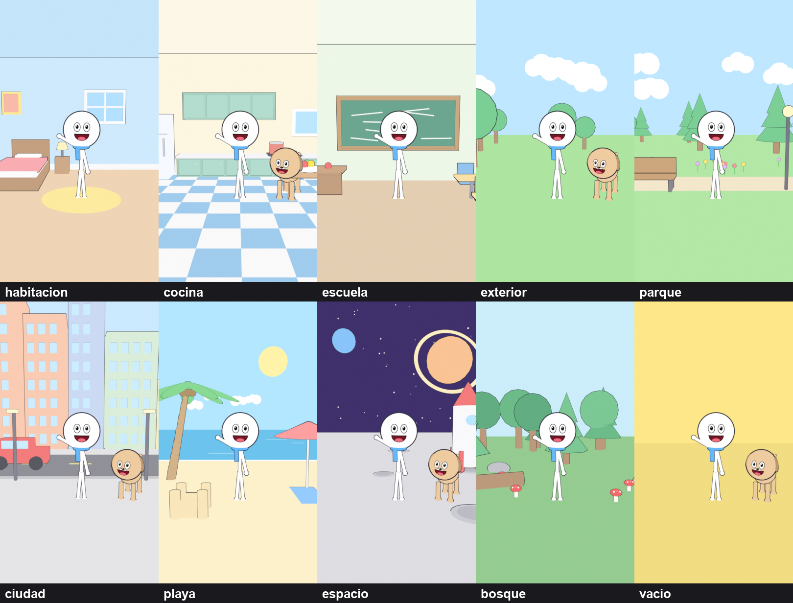

# stick3DD 🎬 Fábrica automática de videos de Sticky

Pipeline que convierte un **guion en JSON** en un **video vertical listo para Shorts/TikTok**, con
animación 3D cartoon, voz narrada, caras expresivas, varios personajes, efectos de sonido y subtítulos.
Hecho para el canal **Curiosidades con Sticky** ([@StickyElCurioso](https://www.youtube.com/@StickyElCurioso)).

La idea: le pides a Claude *"haz un video sobre ¿qué pasaría si no durmieras en 7 días?"* y Claude escribe
el guion, elige escenario, planos, poses, caras, personajes y sonidos, y renderiza el MP4.




## Instalación (Windows)

```powershell
powershell -ExecutionPolicy Bypass -File tools/instalar.ps1
```
Instala Blender 5.3, FFmpeg y las dependencias de Python (numpy, pillow, edge-tts).

## Uso

```powershell
# vista previa rápida: 1 imagen por escena
python pipeline/build.py episodios/demo_reparto/guion.json --preview --calidad 30

# video final
python pipeline/build.py episodios/demo_reparto/guion.json --calidad 100
```
El video queda en `episodios/<nombre>/<nombre>.mp4`.

## Qué trae

- **17 personajes**: Sticky, niño, niña, Doña Rosa, mamá, Don Bigotes, abuelo, chef, doctora, profe, policía,
  rockero, vaquero, perro, gato, pájaro y cerdo. Se definen en [`assets/personajes.json`](assets/personajes.json)
  combinando accesorios (pelo, gorras, sombreros, ropa) y capas de cara (bigote, lentes, pestañas…).
- **10 escenarios**: habitación, cocina, escuela, exterior, parque, ciudad, playa, espacio, bosque y fondo de color, todos con modo noche.
- **12 expresiones**, **12 poses** (más las de animales), **9 planos de cámara** y **10 efectos de sonido**.
- Voz neural en español (edge-tts), subtítulos estilo Shorts y textos grandes en pantalla.

Toda la documentación técnica (formato del guion, catálogo completo y cómo extender) está en [CLAUDE.md](CLAUDE.md).
El historial y los pendientes, en [docs/BITACORA.md](docs/BITACORA.md).

## Estructura

```
assets/        caras, capas de cara, sonidos, personajes.json
pipeline/      build.py (orquestador) + módulos de Blender
tools/         generadores de caras/sonidos, catálogo, instalador
episodios/     un guion.json por video (los renders no se suben)
docs/          bitácora e imágenes del catálogo
```
